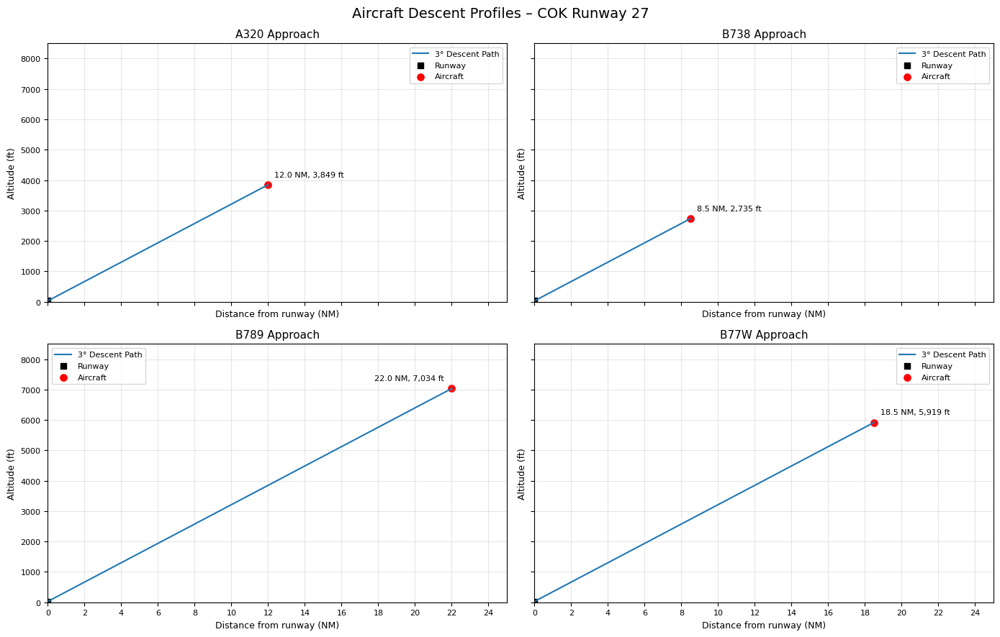
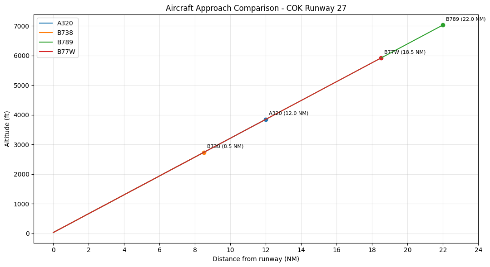

# COK-Aircraft-Performance-Analysis
Python-based aircraft flight mechanics analysis during a simplified terminal approach at Cochin International Airport.

## Project Overview

This project focuses on analysing four commercial aircraft during a simplified 3-degree descent approach. Python is used to calculate and compare different flight and aerodynamic parameters.

## Aircraft Considered

- Airbus A320
- Boeing 737-800 (B738)
- Boeing 787-9 (B789)
- Boeing 777-300ER (B77W)

## Parameters Analysed

- Aircraft altitude
- Equivalent airspeed (EAS)
- True airspeed (TAS)
- Lift coefficient (CL)
- Drag coefficient (CD)
- Aerodynamic drag
- Estimated thrust requirement
- Vertical speed
  
## Tools and Technologies

- Google Colab – for developing and running the project.
- Python – for implementing the flight mechanics calculations.
- NumPy – for numerical calculations.
- Pandas – for handling and organizing data.
- Matplotlib – for plotting and visualizing results.

## How to Run

1. Download the `.ipynb` notebook from this repository.
2. Open Google Colab.
3. Select File → Upload notebook.
4. Upload the downloaded notebook.
5. Run the cells in sequence to perform the analysis and generate the graphs.

## Methodology

A simplified 3-degree descent path is used for the analysis. The International Standard Atmosphere (ISA) model is used to estimate atmospheric temperature, pressure and density.

The calculations include airspeed conversion, lift coefficient, drag coefficient, aerodynamic drag, thrust requirement and vertical speed.

The calculated results are presented through graphs to compare the four aircraft.

## Results and Observations

The model generates individual and combined aircraft descent profiles, along with performance comparison graphs.

Based on the calculated results:

- B77W has the highest estimated aerodynamic drag.
- B77W has the highest estimated thrust requirement.
- B789 has the highest calculated true airspeed.
- B789 has the highest magnitude of vertical speed.

## Assumptions and Limitations

- A constant 3-degree descent angle is assumed.
- Aircraft mass remains constant throughout the simulation.
- ISA atmospheric conditions are considered.
- Wind and turbulence effects are not included.
- Changes in aircraft configuration are not modelled.
- Hypothetical aircraft scenarios are used instead of actual flight data.

The results are estimates from a simplified educational model and are not intended for operational flight planning.

## How to Run

1. Open the notebook available in this repository.
2. Click the **Open in Colab** option, or download the `.ipynb` file.
3. If downloaded, open [Google Colab](https://colab.research.google.com/).
4. Select File → Upload notebook and upload the downloaded file.
5. Run the cells in sequence to perform the calculations and generate the results and graphs.
   
## Visual Results

### Aircraft Approach Profiles

### Aircraft Performance Comparison

## Project Status

Completed – Simplified aircraft terminal approach analysis.

## Author
Bhagyalakshmi Manoj
